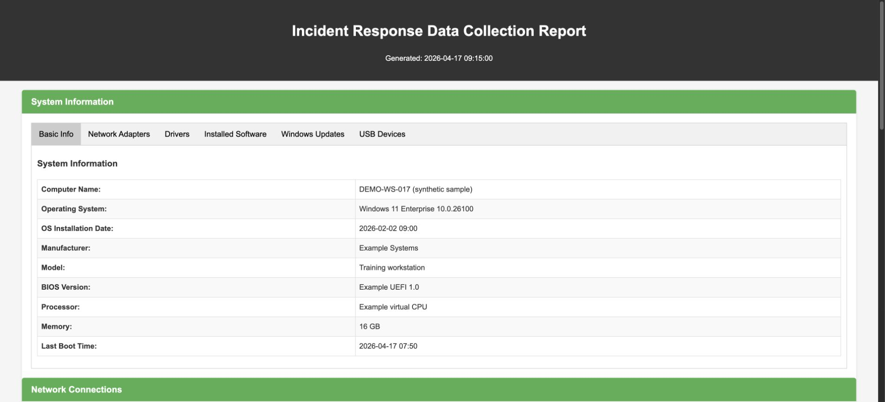

# Windows incident response collector

I wrote this PowerShell collector to give incident responders a single view of a Windows workstation. It gathers endpoint, network, user, and browser artifacts and writes a tabbed HTML report. The current entry point is [IR_Data_Collection_v5.ps1](IR_Data_Collection_v5.ps1).

## Inspect a sample investigation

In the synthetic report, Edge has process ID `4240`. The active connections table ties that process to `198.51.100.24:443`. The DNS cache maps the address to `support.example`, and Edge history records a visit to its help page. You can follow that sequence without running the collector. [Download the sample HTML report](https://github.com/NimdaNona/IR_Investigation/raw/refs/heads/main/examples/sample-report.html)



The example contains invented records and uses the same formatter as the collector. To regenerate it locally with PowerShell, run the [sample script](examples/New-SampleReport.ps1) from the repository root.

```powershell
.\examples\New-SampleReport.ps1
```

## Collect on Windows

On the Windows endpoint under investigation, open PowerShell 5.1 or later in the repository directory. Administrator access gives the collector access to additional records.

```powershell
.\IR_Data_Collection_v5.ps1
```

By default, the collector writes `C:\Investigation\DFIR_Report_<computer>_<timestamp>.html`. The following command sets a destination and opens the completed report in your browser.

```powershell
.\IR_Data_Collection_v5.ps1 -OutputPath 'C:\Investigation\case-017.html' -OpenReport
```

## What the report contains

| Section | Artifacts available for review |
| --- | --- |
| System | OS and boot time, hardware, adapters, drivers, installed software, updates, and USB storage history |
| Network | Active connections and owning processes, listening ports, SMB shares, and DNS cache |
| Processes and persistence | Running processes and parent PIDs, services, scheduled tasks, autoruns, and startup programs |
| Users | Local accounts, active sessions, PowerShell history, and Remote Desktop session history |
| Files and directories | File names, sizes, attributes, and timestamps from selected system and user directories |
| Browsers | Recent Chrome and Edge history for the selected profile, including visit time, title, URL, and count |

Collection is a point-in-time snapshot. Access rights, browser profiles, and available history affect coverage. The script writes a timestamped `DFIR_Log_*.txt` under `%TEMP%`. Check that log when a section is empty. Browser-history collection can create temporary database copies, install NuGet and the PSSQLite module, and attempt a SQLite library download if the module is unavailable. Treat reports from actual endpoints as case evidence because they can contain usernames, private URLs, and command history.

The unnumbered script and versions 2–4 remain available for earlier workflows.

**Sterling Clifton** · [Portfolio](https://sterlingclifton.com/)
